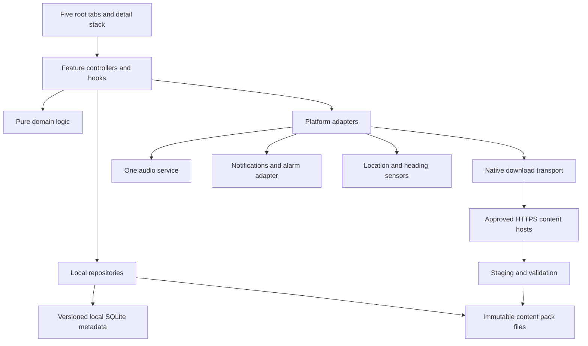

# Application architecture

Status: proposed implementation baseline, grounded in the current checkout. Android is the release target; iOS remains a future validation target. No runtime code has been changed by this kit.

## Boundaries

The UI always reads installed content locally. Network access is limited to user-initiated content acquisition, optional catalog refresh and explicit external links. Calculation of prayer times and Qibla bearing is local. No user account, application backend, remote database, cloud progress sync or push-notification server is required.

## Proposed source layout (future implementation)

| Path | Responsibility |
| --- | --- |
| src/app/ | Bootstrap, provider composition, migration barrier, navigation, linking |
| src/ui/ | Tokens, text, icons, shared components; no Quran/provider business logic |
| src/features/devotional/ | Ruqya, adhkar, dua, tasbih, counters and references |
| src/features/quran/ | Edition library, reader, translation selection and search |
| src/features/downloads/ | Queue UI, install/delete orchestration and storage |
| src/features/audio/ | Player state, queue, repeat and sleep timer |
| src/features/prayer/ | City, prayer schedules, Qibla, adhan settings |
| src/features/settings/ | Appearance, reminders, About, sources, privacy/terms |
| src/domain/ | Stable IDs, pack/riwaya rules, calculations and state transitions |
| src/repositories/ | Content, user metadata, catalog, bookmarks, download records |
| src/platform/ | Audio, file operations, native downloads, alarms, sensors, permissions |
| src/content/ | Bundled reviewed devotional data and catalog seed; no large Quran audio |

Move files when their feature is touched, not as a large preliminary reorganization. Preserve scoped React Context state where sufficient. Use focused hooks and repository subscriptions; do not add Redux or a global state framework just for this redesign.

## State ownership

| State | Owner | Durable form |
| --- | --- | --- |
| Theme preference, UI sizing, Wi-Fi preference, onboarding flags | Settings repository | Versioned settings record in local metadata DB after migration |
| Devotional remaining counts | Devotional repository | stable content ID → integer; transaction per logical update, batched writes |
| Bookmarks and reading positions | Bookmark repository | Edition-aware IDs and position metadata |
| Installed pack registry | Content repository | Version, directory, validation hash, capabilities |
| Download intent and status | Download repository | Job ID and native transport ID; native transport owns live transfer state |
| Audio queue/playback | Single audio service | Native session live; periodically persisted resume position, never auto-play on launch |
| Prayer settings and desired alerts | Prayer repository | City coordinates, IANA zone, method/version, offsets and modes |
| Effective scheduled alerts | Notification adapter | IDs, UTC instants, settings generation and capability status |
| Search query and open sheets | Screen controller | Ephemeral; optional local recent-search history only |

Use a local SQLite metadata database for transactional migration and install/queue records; this is on the device, not a server database. Keep the current AsyncStorage keys as read-only migration input until the migration is verified. Evaluate OP-SQLite behind one repository adapter in RQ-004; pin a version only after the RN 0.84/Hermes/new-architecture smoke test. Do not store audio blobs or the whole Quran inside AsyncStorage.

Canonical Quran data lives in immutable pack files, with one chapter payload per file and a separate derived search index. Load only the open chapter and a bounded neighboring window. Search uses normalized copies, never altered canonical text. A page-image edition exposes fewer capabilities and must not pretend to support reflow or verse-level search.

## Navigation

Root stack: Bootstrap → Welcome/Guide/Guidance when applicable → MainTabs. Root tabs, visually right-to-left: RuqyaTab, QuranTab, AdhkarTab, PrayerTab, MoreTab. Detail routes sit above MainTabs so they have no persistent tabs. More exposes dua, tasbih, bookmarks, downloads, reminders, settings, sources, About and legal pages. Adhkar can also link to dua/tasbih.

Keep route names stable and typed; screen IDs are design identifiers, not route names. Preserve old URLs roqia://home, roqia://adkar/morning, /night, /before-sleep, roqia://duaa, /tasbihat and /about as aliases. New Quran links require editionId + surah + verse/page locator. Validate all route parameters and installed content before navigating. Hold cold-start links until hydration/onboarding is ready, then consume once.

## Interfaces to define before UI integration

- ContentRepository: list editions, get capabilities, open chapter/page, get canonical verse, check installed version.
- DownloadCoordinator: enqueue assets, pause, resume, cancel, reconcile native jobs, verify/install, remove.
- AudioController: replace/enqueue queue, play, pause, seek, stop, repeat, sleep deadline; one observable session.
- PrayerEngine: calculate civil-day schedule from coordinates, IANA zone, method and offsets; return UTC instants plus provenance.
- HeadingAdapter: true heading/confidence or explicit unavailable; LocationAdapter: one-shot request or manual city.
- AlertScheduler: reconcile desired events against effective OS permissions, schedule, cancel, report coverage horizon.

Adapters return typed failures (offline, permission denied, no sensor, missing file, unsupported format, corrupt content); screens map them to copy keys and recovery actions. Do not silently translate failures into success, empty results or stopped playback.

## Dependency plan

Reuse React Navigation, Notifee and the existing Track Player integration. Current Track Player is 5.0.0-alpha0; do not assume stable-version documentation matches it. RQ-032 tests the current version and chooses a proven compatible version/API before migration. Candidate additions: react-native-svg for supplied vectors; OP-SQLite for local metadata; @kesha-antonov/react-native-background-downloader for native transfers; a compatible file/hash adapter; adhan for local astronomical calculation. Each new native package needs a pinned-version compatibility result, not merely a package install.

Downloads and media do not depend on React screen lifetimes. Adhan may require a small Android-specific alarm/playback adapter beyond Notifee's notification API. That is an explicit early spike. No promise of precise background adhan is made from a JavaScript timer.
