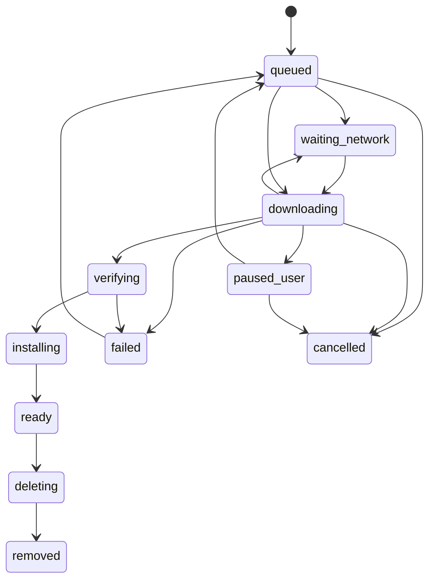

# Offline downloads and storage

Screens 24, 28, 34–37 and 48. The UI submits durable download intent; native transport performs byte transfer; validation determines when a file is usable. The app has no backend account service. Static files still need a reachable approved host for their first download.

## Catalog and hosting

Bundle a small reviewed catalog seed with the app. Each pack has stable ID/version, source attribution, capabilities, exact asset list, sizes where known, SHA-256 checksums, MIME type, riwaya/edition/translation compatibility and HTTPS URL. Ship a new bundled catalog with app updates initially. Optional later catalog refresh must use a signed manifest with an embedded public verification key, schema/version checks and a retained last-good catalog. Private signing material belongs in maintainer tooling, never the mobile app.

Use official public file URLs when durable, permitted and technically suitable. If repackaging is required, host approved immutable packs on static storage with HTTPS and range support. That introduces hosting/bandwidth operations but no user database or application API. Do not assume an unlimited free service. No secret API key is needed for the documented public MP3Quran catalog; do not embed maintainer credentials or guess private Warsh endpoints.

Audio is one asset per surah/recording/quality, so selecting three chapters downloads three files. “Whole mushaf” queues only the available chapters and clearly reports incompleteness; it must not mean “114” unless the catalog proves it. Economy/high quality appears only if distinct verified files exist. Text/font packs and translation packs are separate from audio packs.

## Storage structure

Use durable app-private files, not an evictable cache or base64 in AsyncStorage. Suggested layout:

```text
files/roqia/
  metadata.sqlite
  staging/<jobId>/<assetId>.part
  content/<packId>/<version>/...
  audio/<recordingSetId>/<quality>/<surahNumber>.mp3
  recovery/<migration-or-install-record>
```

Do not request broad external-storage permission. Store relative paths in the metadata DB and resolve them against the current app-private root. Downloads are not backup content; preserve the repository's current no-backup behavior until an explicit backup feature is designed.

## Transfer state machine



Every transition records generation/revision and is idempotent. Ignore stale progress/completion callbacks after cancellation or a new attempt. Key a job by asset ID + version; repeated taps attach to the same job. A user's pause never resumes merely because Wi-Fi returns. Network-paused transfers can resume if the original consent and current policy still permit it.

Start with two concurrent transfers, bounded retries (3 attempts with backoff/jitter), explicit retry after exhaustion, and no retry loop for unavailable/forbidden content. Read transport progress no more often than needed for UI; avoid writing SQLite on every byte event. Reconcile persisted jobs against native transport on startup and resume. Process death is different from Android force-stop; never promise work will run while the OS has force-stopped the application.

## Resume and verification rules

The selected candidate native downloader documents pause/resume and reattachment; Android resume requires server range support. RQ-020 verifies that behavior on the pinned app stack and actual hosts. [Downloader API](https://github.com/kesha-antonov/react-native-background-downloader/blob/main/docs/API.md).

For resumable files require byte-range correctness: append only a valid 206 response whose Content-Range starts at the stored length and whose entity validator remains compatible. A 200 response to a resume request replaces the partial file; it must not append. An ETag/Last-Modified mismatch restarts with user-visible explanation. A 416 response verifies a potentially complete file or restarts safely. If the chosen transport cannot expose/enforce these guarantees, RQ-020 must select or extend the adapter before declaring reliable resume.

After transfer, verify size if declared, SHA-256, media/type signature and pack structure. An HTTP success containing an HTML error page is not audio. Unknown Content-Length gives indeterminate progress, not a fake percentage. A maintainer-generated checksum detects unexpected bytes but does not independently establish religious content accuracy.

For text/font packs validate all files before activation. Prefer an explicit file manifest to a generic archive. If an archive is used, reject absolute paths, traversal, symlinks, unexpected files and decompression beyond declared limits. Downloaded material is never executable code.

## Atomic install and crash recovery

Stage → verify → atomically rename on the same filesystem → mark installed in a DB transaction. File rename and DB commit are not one atomic operation: use an install journal. After a crash, a validated final directory without a registry entry is recovered from the journal; a registry entry missing files becomes missing/corrupt, never ready. Old installed versions remain active until the new registry switch commits. Do not delete the old pack while a reader has it open.

Deletion similarly records deleting, stops dependent playback, removes bytes and commits removed. Retry deletion after interruption. Storage totals derive from actual installed/partial files; show temporary space separately when meaningful. Before starting, check free bytes for remaining transfer + unpacked content + a margin (proposed max of 10% or 20 MB), and handle disk-full races during writes. Unknown-size downloads require conservative limits and an explicit no-space recovery state.

## UI contract

Show downloaded, queued, waiting Wi-Fi, user-paused, network-paused, verifying, installing, failed and missing distinctly. Preserve completed files when another transfer fails. Wi-Fi-only is on by default, enforced in the native transport; a cellular override requires an explicit user action. Cancel removes partial bytes and job intent; deleting a ready file is a separate confirmed action. The app remains usable offline through all download failures.
